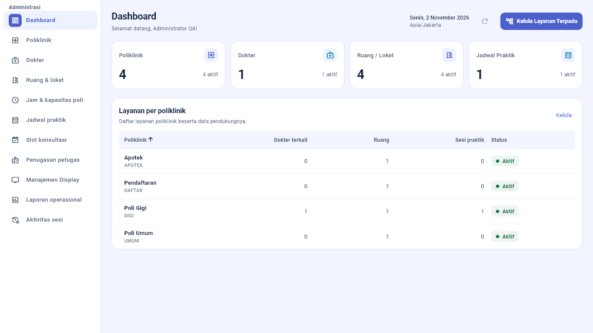

# ADMIN — layout dan tipografi, 2 November 2026

Permintaan: memperbarui kesan ADMIN yang terasa lawas melalui perubahan terarah pada UI, layout dan tipografi. Acuan hanya panduan QueueB dan kebutuhan operasional. Tidak menggunakan panduan desain pihak ketiga atau mengubah tema portal lain.

## Perubahan

- Heading halaman bersama: judul 22 semibold/bold, keterangan 12, jarak dan penempatan aksi konsisten. Aksi membungkus pada layar sempit atau teks diperbesar.
- Tombol Kelola Layanan Terpadu dipindahkan ke header Dashboard; callback dan workflow wizard dipertahankan.
- Kartu ringkasan: label dan ikon ringkas di atas, angka utama 30 dengan tabular figures, jumlah aktif sebagai konteks. Semua angka tetap berasal dari katalog; data belum tersedia memakai tanda —.
- Panel tanpa shadow dekoratif, border ringan, radius panel 16 dan kontrol 10. Tema ADMIN di-cache; biru/periwinkle, branding dan font Material existing dipertahankan.
- Sidebar lebih leluasa (232/72), indikator pilihan lebih jelas, tujuan tetap langsung tanpa accordion baru. Semua sebelas tujuan dan aksi profil tetap tersedia.
- Filter/search berada dalam panel tersendiri; status lebih lebar agar teks pilihan lebih terbaca. Search, filter, callback, status dan pagination existing dipertahankan.
- Tabel Dashboard menampilkan nama/kode dengan hierarki berbeda dan label status yang jelas. Pagination bernomor delapan baris, footer hanya saat diperlukan; data sesudah halaman pertama tetap dapat diakses.
- Heading laporan/aktivitas sesi mengikuti komponen yang sama. Tidak ada grafik, pertumbuhan, kuota, atau estimasi buatan.

## Preview

Screenshot berikut merupakan render widget Flutter dengan font Roboto/Material Icons SDK dan **data uji sintetis**, bukan tangkapan akun/data development pengguna. Preview menampilkan area isi dan navigasi; app bar branding existing tetap pada shell aplikasi.

[Preview mobile 390 px](images/admin-modern-20261102/dashboard-390.png).

## Verifikasi

- Flutter analyze --no-pub: **No issues found**, 127,0 detik.
- Tes visual existing: 10 lulus, mencakup data katalog, reload/navigasi KPI, hover dan aksesibilitas tabel.
- Tes layout/regresi ADMIN: 24 lulus dalam sekitar 6 detik; viewport 320, 390, 768, 1280, 1366, 1440, 1920 dan text scale 1×/2×, pagination 17 layanan, pencarian/filter/aksi dokter, agenda berpaginasi serta pemuatan slot hanya saat diperluas.
- Tambahan viewport 360×800 dan 412×915 pada text scale 1×/2×: empat tes lulus dalam sekitar satu detik. Total 38 tes terkait lulus pada beberapa eksekusi terfokus; seluruh suite proyek tidak dijalankan.
- Build Web JavaScript `--no-pub --no-wasm-dry-run`: berhasil, kompilasi 74,6 detik. Build Wasm tidak diuji.
- Format source/tes terkait dan git diff --check: lulus; pemberitahuan konversi line ending Git tetap ada.

Fixture slot disesuaikan dengan pembacaan endpoint kesiapan yang telah ditambahkan pada pekerjaan sebelumnya; pengujian tetap memastikan hanya satu request slot dan tidak ada pemuatan slot sebelum sesi diperluas. Percobaan awal fixture capture/font dan timezone diperbaiki sebelum hasil akhir di atas; log lokal tersedia pada `apps/client/build/admin-modern-*.log`.

Tidak menjalankan seluruh suite proyek, pengujian database, atau validasi browser/perangkat fisik. Tidak ada perubahan backend/API/RBAC/migration/database pada pekerjaan visual ini. Tidak ada staging, commit atau push.
