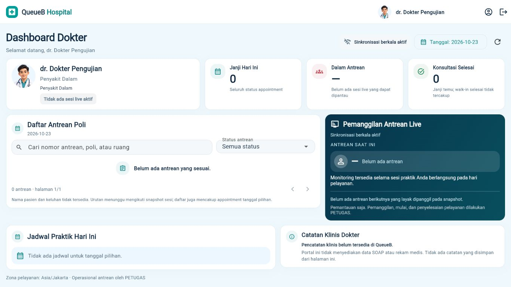

# Review revisi compact Dashboard Dokter

Baseline: `1d72df8` pada branch `codex/doctor-dashboard-visual-refresh`. Revisi ini dibiarkan sebagai perubahan lokal untuk review; tidak di-stage, commit, atau push.

## Penyesuaian visual

| Elemen | Sebelumnya | Revisi |
| --- | --- | --- |
| Padding halaman | 24 px | 16 px |
| Padding kartu | 20 px; live 22 px | 14 px |
| Radius kartu utama | 20 px | 16 px, token bersama |
| Avatar profil desktop | 96 px | 64 px |
| Judul halaman | 32 px | 28 px |
| Ikon KPI | 52 px | 40 px |
| Empty state antrean | Ilustrasi 100 px dengan teks bertingkat | Baris ikon 36 px dan pesan singkat |
| Catatan klinis | Judul berikon + info card di dalam panel | Satu info singkat, tanpa lapisan kartu tambahan |

Jarak antarbagian dikurangi menjadi 12 px. Search dan filter lebih rapat; baris tabel lebih ringkas. Panel live kosong memakai placeholder horizontal dan mengurangi padding dekoratif, tanpa menyembunyikan status koneksi, ketersediaan monitoring, informasi antrean berikutnya, atau batas kewenangan PETUGAS.

Tidak ada tinggi halaman/kartu yang dipaksa agar konten terpotong. Daftar panjang, nama panjang, dan ukuran teks lebih besar tetap dapat menambah tinggi secara alami. Scroll vertikal dan scroll horizontal internal tabel existing dipertahankan.

## File

- `apps/client/lib/src/doctor_dashboard.dart`: spacing, proporsi kartu/grid, placeholder loading dengan slot stabil, panel live, dan info klinis ringkas.
- `apps/client/lib/src/doctor_visual.dart`: token radius/padding/gap, judul bagian, ikon, dan empty state ringkas.
- `apps/client/test/doctor_visual_refresh_test.dart`: regresi posisi bagian bawah pada laptop 1366×768 dan batas ukuran empty state.
- Dokumen ini dan screenshot review terpisah dari screenshot baseline sebelumnya.

## Perilaku data

Tidak ada perubahan backend, endpoint, model, autentikasi, RBAC, session, Socket.IO, `DoctorPage`, atau callback operasional. Penghitungan KPI, urutan/eligibilitas snapshot, pencarian, filter, pagination, pemilihan antrean aktif, dan detail dipertahankan.

Slot indikator loading dipertahankan pada posisi widget yang stabil agar pencarian/filter tidak ter-reset selama refresh. Regresi existing untuk kasus tersebut tetap dijalankan.

## Validasi

- `flutter analyze --no-pub`: PASS, tanpa temuan.
- `flutter test --no-pub --reporter expanded`: PASS, **235 tes lulus**, 1 tes live integration existing dilewati sesuai gate runner/database test.
- `dart format --output=none --set-exit-if-changed lib test`: PASS, 55 file tanpa perubahan format.
- `flutter build web --no-pub --dart-define=API_BASE_URL=http://localhost:3000/api/v1 --dart-define=SERVICE_TIME_ZONE=Asia/Jakarta`: PASS, output `apps/client/build/web`.
- `git diff --check`: PASS; staging kosong; HEAD tetap `1d72df8`.
- Seluruh 42 file lokal pengguna tetap identik dengan hash baseline.

Pada browser 1366×768, kondisi kosong menampilkan profil/KPI, antrean, monitoring live, jadwal, info klinis, dan footer dalam satu viewport. Pada fixture tiga antrean, antrean dan monitoring live terlihat utuh, sementara judul bagian bawah sudah terlihat; data lebih panjang tetap menggunakan scroll alami. Tidak ada overflow horizontal halaman (`documentWidth == viewportWidth == 1366`). Screenshot tambahan diambil pada 1920×1080, 768×1024, dan 375×900.

Pencarian `PD-002` tetap tersimpan setelah refresh pada QA browser. Full suite mencakup regresi filter/pagination/detail, realtime/reconnect, tanggal, loading/error, sesi/logout dan role existing. Struktur perhitungan `DoctorDashboardData`, filter/pagination, serta pemilihan tiket live diperiksa tetap identik dengan baseline.

Preview browser menggunakan HTTP fixture sintetis yang terisolasi dari database. Tes socket menggunakan simulasi dalam regresi existing; tidak ada klaim pengujian backend live atau perangkat fisik pada revisi visual ini. Peringatan dry-run Wasm dependency existing tidak menghalangi build Web JavaScript.

## Screenshot untuk review

Laptop 1366×768, kondisi kosong:

[Antrean terisi 1366×768](images/doctor-compact/active-1366.jpg) · [Desktop 1920×1080](images/doctor-compact/desktop-1920.jpg) · [Tablet 768×1024](images/doctor-compact/tablet-768.jpg) · [Mobile 375×900](images/doctor-compact/mobile-375.jpg)

[Screenshot baseline sebelum revisi](images/doctor-refresh/laptop-1366.jpg) dipertahankan untuk perbandingan.
