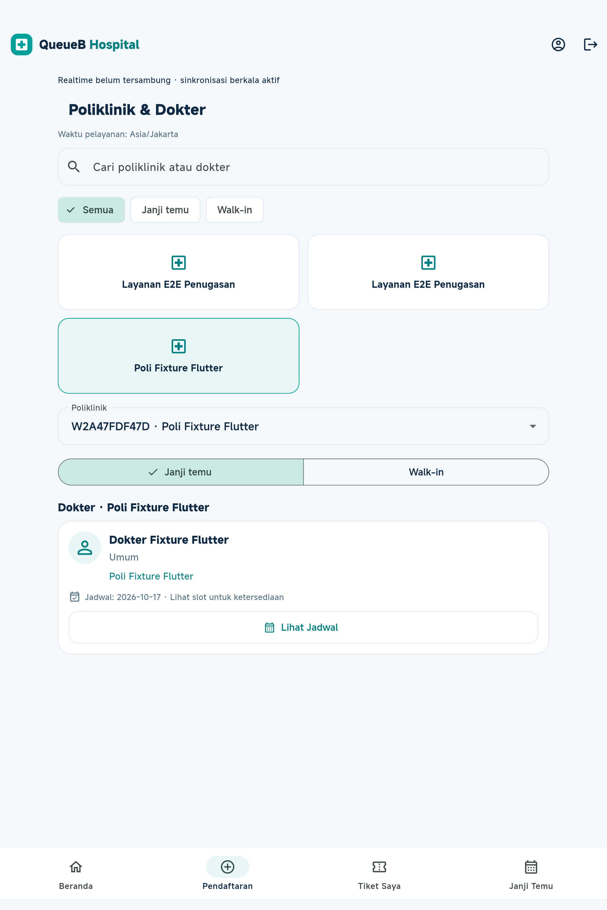
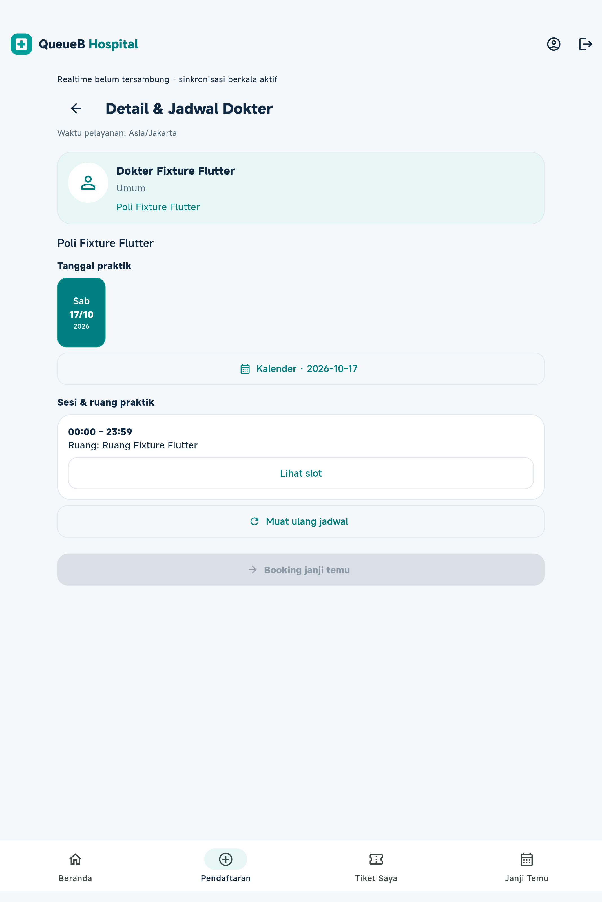
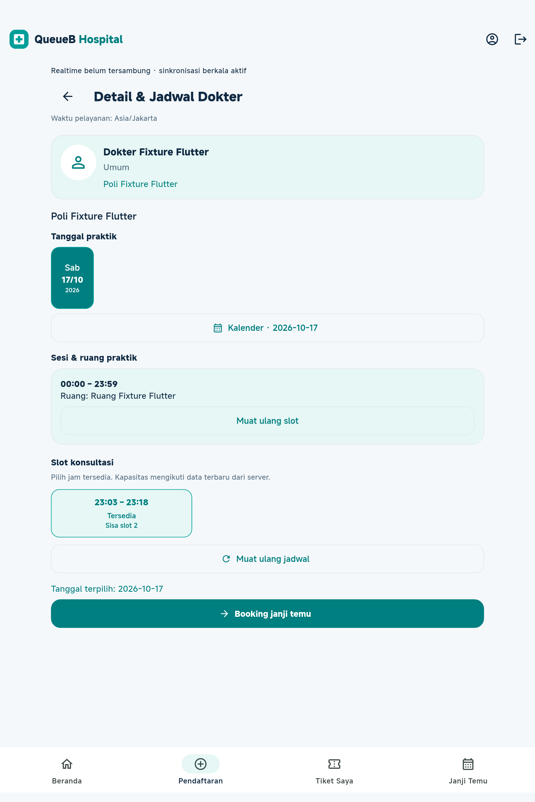

# Informasi dokter dan jadwal praktik mobile

Implementasi pada `apps/client` melanjutkan halaman Pendaftaran existing. Tema QueueB teal, Material 3, navigasi bawah, persistent login dan satu koneksi realtime pasien tetap digunakan. Backend, schema dan migration tidak berubah.

## Alur demo

1. Masuk sebagai USER → **Janji Temu Dokter** atau **Pendaftaran**.
2. Cari nama poliklinik/dokter, pilih poliklinik. Kartu menampilkan dokter yang memiliki relasi aktif, spesialisasi dan tanggal praktik aktual.
3. Pilih **Lihat Jadwal** untuk profil dokter dan poliklinik yang dilayani.
4. Pilih tanggal pada kalender horizontal atau tombol **Kalender**. Tanggal yang dapat dipilih berasal dari jadwal API; tidak dibuat dari template mingguan. Kalender biasa hanya mengaktifkan tanggal praktik tersebut.
5. Pilih sesi/ruang → **Lihat slot**. Grid membedakan tersedia, penuh, tidak aktif (bila diberikan API), tidak tersedia dan terpilih. Endpoint USER menyembunyikan slot nonaktif; aplikasi tidak membuat slot pengganti.
6. Pilih jam → **Booking janji temu** → konfirmasi. Setelah berhasil, **Tiket Saya** membaca tiket milik pasien dari backend; ID appointment tidak digunakan sebagai ID tiket.
7. Untuk walk-in, pilih **Daftar Walk-in**, poliklinik dan tanggal pelayanan → **Reservasi walk-in**. Alur QR/petugas tetap sama.

Tidak ada rating, ulasan, harga, pengalaman atau foto buatan. Avatar menggunakan ikon default. Label tanggal praktik tidak menjanjikan slot tersedia; ketersediaan booking hanya mengikuti `tersedia` dari backend, termasuk batas kuota harian dan awal slot.

## Kontrak API

Mengikuti `docs/backend/API_INTEGRATION_GUIDE.md` dan controller/DTO existing:

| Kebutuhan | Request |
| --- | --- |
| Poliklinik | `GET /layanan` |
| Dokter dan relasi aktif | `GET /dokter` |
| Tanggal praktik pada poli terpilih | `GET /jadwal-praktik?layananId=…` |
| Sesi dokter pada tanggal terpilih | `GET /jadwal-praktik?layananId=…&dokterId=…&tanggal=YYYY-MM-DD` |
| Slot sesi | `GET /slot-praktik?jadwalPraktikId=…` |
| Booking | `POST /janji-temu` dengan `{ "slotPraktikId": "…" }` |
| Tiket dan appointment milik pasien | `GET /tiket/saya`, `GET /janji-temu` |

Field PostgreSQL DATE dibaca sebagai tanggal kalender tanpa konversi perangkat. Timestamp UTC jam sesi/slot ditampilkan melalui `AppConfig` pada `Asia/Jakarta` (`SERVICE_TIME_ZONE`). `API_BASE_URL` tetap melalui `--dart-define`.

Pilihan dokter/tanggal/sesi yang berubah membuang pilihan turunannya. Respons GET lama dijaga dengan revision counter. Invalidasi katalog/foreground membaca ulang kalender, sesi dan slot; slot terpilih dibuang jika `tersedia` berubah. Tidak ada koneksi Socket.IO tambahan.

Respons booking gagal/tidak pasti tidak memicu pengulangan POST otomatis: pilihan slot dibuang, tiket/appointment milik pasien dan ketersediaan dibaca ulang, lalu pesan kesalahan tetap ditampilkan. Pasien dapat memeriksa Tiket Saya sebelum mencoba kembali. Idempotency key belum tersedia pada backend.

## Reproduksi QA

```powershell
cd apps/client
flutter analyze
flutter test --reporter expanded
flutter build web --release --no-web-resources-cdn --no-wasm-dry-run --dart-define=API_BASE_URL=http://127.0.0.1:3001/api/v1
node tool/run-live.cjs --doctor-schedule
node tool/browser-auth-session.cjs
$env:FLUTTER_ANDROID_DEVICE = '<adb-device-id>'
node tool/run-live.cjs --android
flutter build apk --debug --dart-define=API_BASE_URL=http://127.0.0.1:3000/api/v1
flutter build web --release --no-web-resources-cdn --no-wasm-dry-run --dart-define=API_BASE_URL=http://localhost:3000/api/v1
```

Runner live memvalidasi target `127.0.0.1:5433/capstone_antrean_test` dan nama database aktual sebelum membuat fixture unik. Provider Prisma diberi URL test eksplisit; tidak bisa dialihkan file environment ke database utama. Cleanup hanya fixture milik run, disusul perbandingan fingerprint data existing. Tidak menjalankan reset atau migration. Kredensial sementara tidak disimpan dalam laporan.

APK normal menggunakan port 3000 dengan `adb reverse tcp:3000 tcp:3000` untuk API lokal lewat USB. Instrumentasi menggunakan port 3001/3002 milik harness test; jangan gunakan APK instrumentasi untuk demo normal.

## Batas yang dipertahankan

- Daftar jadwal backend belum memiliki pagination; permintaan kalender dibatasi pada poliklinik yang dipilih, slot hanya dibaca untuk sesi yang dibuka.
- Realtime existing bersifat best effort dengan rekonsiliasi foreground dan fallback berkala. Backend tetap memutuskan ketersediaan final saat booking.
- Warning dependency build existing pada `flutter_tts`/KGP dan JDK native access dicatat; tidak mengubah dependency di luar scope.

## Verifikasi aktual

- `flutter analyze`: **No issues found**.
- `flutter test`: **113 PASS**, satu tes live SKIP pada perintah default. Termasuk 13 tes tambahan kalender/slot/empty state, konflik 409, respons jadwal terlambat setelah dokter dinonaktifkan, rekonsiliasi foreground dan responsivitas 320/375/414/768 px.
- Flutter Web release dengan resource lokal: **PASS**.
- APK Android debug aplikasi normal (`lib/main.dart`, API port 3000): **PASS**. APK instrumentasi dibuat terpisah untuk pengujian.
- Browser Edge menjalankan Flutter Web hasil kompilasi terhadap API NestJS nyata: **PASS** pada lebar 320/375/414/768. Slot kapasitas 1 diisi pasien fixture lain melalui API dan tidak dapat dipilih di UI. Booking slot lain berhasil, `slotPraktikId` sesuai pilihan, ID appointment berbeda dari `tiket.id`, lalu Tiket Saya muncul. Lihat [laporan JSON](doctor-schedule-web-qa.json) dan [bukti tiket setelah booking](images/doctor-schedule-booked-web.png).
- Android fisik Xiaomi `2410CRP4CG`: **1/1 instrumentasi PASS**. Appointment dan walk-in → tiket QR → CHECK_IN → ENQUEUE → CALL → RECALL → SKIP → REQUEUE → START → COMPLETE; kedua pasien kembali melihat SELESAI. Kamera mendapatkan izin dan berjalan. Ini verifikasi kamera aktif, bukan bukti kamera fisik berhasil mendekode QR cetak.
- Pengulangan instrumentasi setelah dua perbaikan akhir (batas/clipping header dan loading setelah dokter dinonaktifkan) berhasil membangun APK, tetapi **belum berjalan**: OS menolak pemasangan dengan `INSTALL_FAILED_USER_RESTRICTED / Install canceled by user`. Hasil fisik dan screenshot di atas berasal dari run sukses sebelum dua perubahan tersebut; source final telah diverifikasi oleh 113 tes, analyzer, build dan Web live. Pengulangan fisik membutuhkan persetujuan dialog instalasi USB pada perangkat.
- Tujuh screenshot Android tersimpan lokal di `apps/client/build/android-screenshots`. Tiga screenshot fitur ini disalin ke dokumentasi di bawah.
- Regresi Web autentikasi dengan HTTP terkendali: **ADMIN, PETUGAS, USER PASS**, refresh token tunggal, logout, reload Web kembali login. WebSocket sintetis diisolasi agar JWT fixture tidak terkirim ke server live.
- Target Android live tervalidasi: **127.0.0.1:5433/capstone_antrean_test**. Setelah cleanup: **13 record existing, 0 hilang, 0 berubah, 0 record baru tersisa**.
- Saat build/test paralel ada satu respons snapshot test dengan Prisma `P2028` (waktu memulai transaksi habis). Instrumentasi tetap pulih dan selesai PASS. Tidak mengubah backend atau menaikkan timeout domain untuk menyamarkan kondisi tersebut; hindari build berat bersamaan dengan integrasi database lokal.

### Screenshot Android fisik

| Poliklinik dan dokter | Detail dokter dan kalender | Slot terpilih |
| --- | --- | --- |
|  |  |  |

### Screenshot Flutter Web

- [Poliklinik dan dokter, 375 px](images/doctor-schedule-web-375.png).
- [Detail dan kalender praktik](images/doctor-schedule-detail-web.png).
- [Slot tersedia dan penuh](images/doctor-schedule-slot-web.png).
- [Booking berhasil dan tiket diterbitkan](images/doctor-schedule-booked-web.png).
